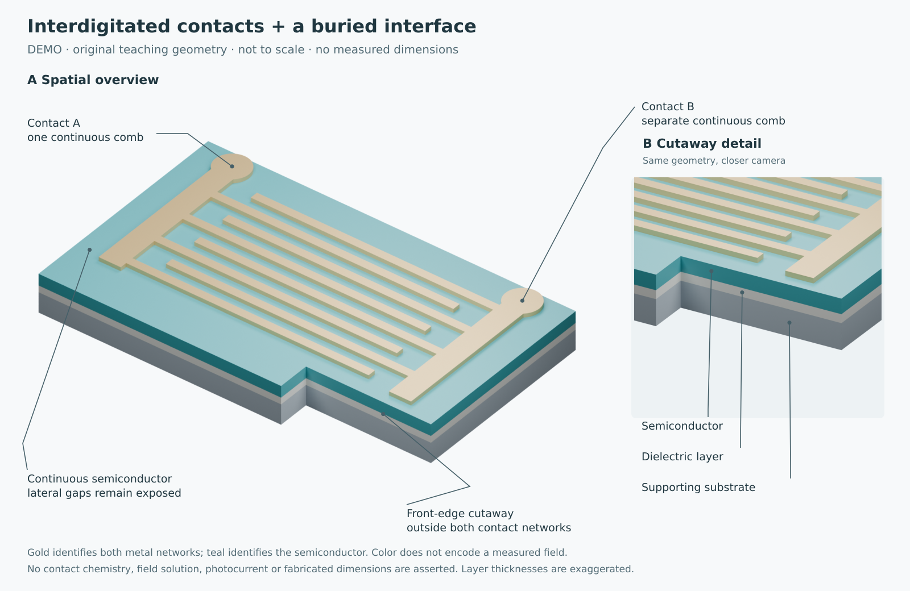

# paper-fig-skills

[中文](README.md) · English · [Example gallery](examples/gallery/README.md)



[Hero source and explanation](deliverables/advanced-device-demo/README.en.md) · [User guide](docs/USER_GUIDE.en.md) · [Color atlas](deliverables/color-atlas.html) · [Historical handbook PDF](deliverables/scientific-figure-handbook.pdf)

Nine complementary skills for scientific figures: define the evidence and comparison, choose an appropriate visual representation, make editable graphics, then inspect scientific meaning, readability and deliverability separately. This is not a fixed journal template or a guarantee of scientific validity.

## Choose a skill

| Skill | Use it for |
|---|---|
| [director](skills/sci-figure-director/SKILL.en.md) | Mixed figures, planning and routing |
| [data](skills/sci-figure-data/SKILL.en.md) | Curves, spectra, uncertainty, complex maps and waterfalls |
| [mechanism](skills/sci-figure-mechanism/SKILL.en.md) | Energy, charge, reactions and competing explanations |
| [device](skills/sci-figure-device/SKILL.en.md) | Layers, contacts, sections, assemblies and optional 3D |
| [process](skills/sci-figure-process/SKILL.en.md) | Growth, operations, time and state changes |
| [image](skills/sci-figure-image/SKILL.en.md) | Evidence pixels, ROIs, volumes and slices |
| [compose](skills/sci-figure-compose/SKILL.en.md) | Unequal panels, reading order and mixed evidence |
| [color](skills/sci-figure-color/SKILL.en.md) | Identity, continuous quantities, missingness and contrast |
| [review](skills/sci-figure-review/SKILL.en.md) | Scoped scientific, visual and editable-source review |

Start with director for a mixed task, or choose the specialist directly. All nine English entrypoints are provided. Historical literature case-study references remain in their original Chinese; the new [complex-view guide](skills/sci-figure-data/references/stacked-views.en.md) is bilingual. This is an English operational edition, not a claim that the entire historical corpus has been translated.

## Get a single language edition

Clone or download this repository. From its root:

```sh
git clone https://github.com/Mr-NuLl-01/paper-fig-skills.git
cd paper-fig-skills
python scripts/export_skills.py --language en --output ../paper-fig-en
```

Use `--language zh` for the Chinese edition. Choose a new output directory: the exporter refuses an existing destination. It copies all supporting resources and replaces the exported `SKILL.md` with the chosen entrypoint. It does not install anything, change your model settings, or contact a service. Install only one language edition of a skill with a given name; do not install parallel duplicates.

Copy the nine exported `sci-figure-*` folders into the local skills directory recognized by your client. The original installation instructions use `$HOME/.agents/skills` (Windows: `$HOME\.agents\skills`); see the [Chinese installation section](README.md#安装macos--linux--windows) for safe, non-overwriting shell/PowerShell commands. Use the exported folder as the source. Check your client's recognized directory, especially for older or customized installations. Restart its skill discovery if needed. No local installation is performed by this release.

## Ask for a figure

```text
Use $sci-figure-director and only the relevant skills from paper-fig-skills.
Make a figure answering [specific comparison]. Inputs: [files and units].
Evidence type: [measured / simulated / conceptual]. Final size: [width/height].
Preserve raw data, independent samples, masks, calibration and editable labels.
Deliver SVG/PDF, preview, generating code and a self-contained caption.
```

For a waterfall:

```text
Use $sci-figure-data to show spectra at irregular temperatures as a 3D waterfall,
with wavelength, actual temperature and intensity as independent axes.
Do not normalize curves individually or add unexplained offsets.
Provide a 2D companion view with the same data, code and camera settings.
```

## Run the eight new examples

These are synthetic demonstrations, not experimental findings. The gallery includes both basic and complex views, skill-use records and model disclosure.

```sh
python -m venv .venv
# Activate this environment using your platform's normal command.
python -m pip install -r examples/gallery/requirements.txt
python examples/gallery/generate.py
python examples/gallery/check.py
```

On Windows, use `py` instead of `python` if appropriate. The eight base examples need no Codex, API key, external image generation or Blender. The additional native 3D device companion uses Blender; its separate commands are in the gallery. Linux execution was checked; Windows/macOS execution is not claimed. Open `examples/gallery/output/*.png` for previews; SVG retains live text and vector geometry, PDF is included, and scripts/data allow regeneration or changes to the 3D camera. A projected SVG is not a native 3D scene.

## Provenance and limits

The original corpus records 89 papers and 178 selected figures, with its own reading scope. It does not imply that this update reread all sources. [PROVENANCE.md](PROVENANCE.md) and the [historical import manifest](docs/history/skill-manifest-20261017.json) preserve the import history. [KNOWN_ISSUES.md](KNOWN_ISSUES.md) documents original scanner and color-preview limitations; they are not silently declared fixed by the new examples.

New editable examples are generated with this repository's skills only. Read [the gallery record](examples/gallery/README.md) for the exact scope, source hashes, model information and review limits. All numeric values and conceptual structures are invented for demonstration. Third-party paper figures/full text are not redistributed.

[MIT License](LICENSE) applies as already established in this repository; third-party research and trademarks retain their own rights. See [contribution instructions](CONTRIBUTING.md) and [changes](CHANGELOG.md).
